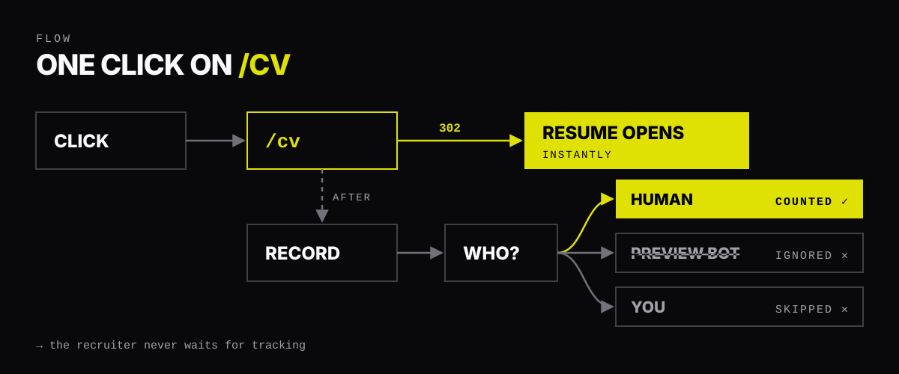

<div align="center">


# Pingback

One link to your resume that tells you if it was really opened.

**[Live demo](https://pingback.air01aditya.workers.dev)**

</div>

## How it works

You share one link, `/cv`. It opens your resume straight away, then counts the visit.
Link-preview bots and your own clicks don't count.



Built with Cloudflare Workers and D1. No runtime dependencies.

## Run it yourself

```bash
npm install
cp .dev.vars.example .dev.vars     # paste the output of `npm run secret`
npm run db:migrate:local
npm run dev
```

Open `http://localhost:8787/setup#key=<SETUP_SECRET>` once, then add your resume link at `/app`.

## License

[MIT](LICENSE)
